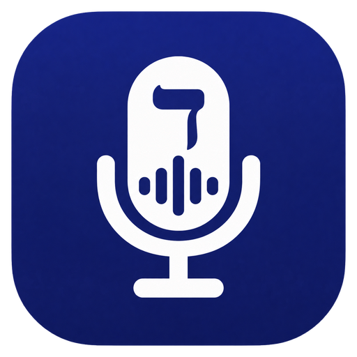

  

<h1 align="center">Dibbur (דיבור)</h1>

  <strong>Hebrew voice dictation for Mac that actually works.</strong> 
  Press a shortcut, speak Hebrew or Arabic, 
  and the text appears in any app. 
  Free, open source, and fully offline.

  <strong>הכתבה קולית בעברית ובערבית למק.</strong> 
  לוחצים על קיצור, מדברים עברית או ערבית, 
  והטקסט מופיע איפה שהסמן נמצא. 
  בחינם, בקוד פתוח, הכל נשאר על המחשב.

  <strong>إملاء صوتي بالعربي والعبري للماك.</strong> 
  تضغط على الاختصار وتحكي عربي أو عبري، 
  والنص بيطلع وين ما كان المؤشر. 
  مجاني ومفتوح المصدر، وكل شي محلي.

  
  
  
  
  

---

Dibbur is a free, open-source alternative to Wispr Flow and Dragon for Hebrew and Arabic speakers. It is a fork of [Handy](https://github.com/cjpais/Handy) (MIT) with one goal: make open-source dictation actually good in Hebrew.

## Why Dibbur?

- **Hebrew accuracy first** - ships with the [ivrit-ai](https://huggingface.co/ivrit-ai) Whisper large-v3-turbo model (Apache-2.0), the strongest open Hebrew speech model: about 7% word-error rate on real WhatsApp Hebrew per the [ivrit-ai leaderboard](https://huggingface.co/spaces/ivrit-ai/hebrew-transcription-leaderboard), ahead of the big commercial APIs on Hebrew.
- **Private by default** - speech-to-text runs on your Mac. Your voice never leaves the computer.
- **Works in every app** - hold your shortcut, talk, release: the text is pasted wherever your cursor is - WhatsApp, Gmail, Docs, Cursor.
- **Arabic too** - the optional **Lahjat Turbo** model (oddadmix dialectal fine-tune, Apache-2.0) is the strongest open Arabic dialect model: about 31% WER on Palestinian, 35% Lebanese, 25% Egyptian and 17% Gulf Arabic, where stock Whisper lands at 38-53%.
- **Transcript archive (optional)** - turn on **Save Transcripts** in Settings > Advanced > History and every dictation is appended to a daily Markdown file in a local folder (default `~/Documents/Dibbur Transcripts`). Nothing leaves your Mac unless you put the folder inside iCloud Drive or Google Drive. Off by default.
- **Optional AI cleanup (off by default)** - removes Hebrew filler words (אממ, כאילו, נו...), fixes punctuation, keeps your language. Works with a free API key (Gemini, Groq), a local model through Ollama, or Apple Intelligence.

## Install (macOS)

1. Download the DMG from [Releases](https://github.com/ofershap/dibbur/releases/latest): `aarch64` for Apple Silicon (M1/M2/M3/M4), `x64` for Intel.
2. Open the DMG and drag Dibbur into Applications.
3. First launch: right-click Dibbur > Open > Open. The app is unsigned for now, so macOS asks once.
4. Allow Microphone and Accessibility when macOS asks.
5. First run downloads the **Ivrit Turbo** Hebrew model by itself (one-time ~1.6 GB) with a progress bar; adding Arabic is one optional tap on the same screen.
6. Pick your keyboard shortcut in Settings, press it, and speak Hebrew.

## FAQ

Is Dibbur really offline?

Yes. Transcription runs locally with a Whisper engine on your machine, with no account and no cloud. The only network calls are the one-time model download and the optional text-cleanup step, which is off by default.

Which Macs are supported?

Both Apple Silicon and Intel. Apple Silicon is strongly recommended - the large-v3-turbo model transcribes in near real time there; on Intel it works but is noticeably slower.

Can it transcribe English too?

Yes. The bundled Ivrit Turbo model is Hebrew-first but handles mixed Hebrew-English speech. You can also switch to any of the general Whisper and Parakeet models built into the app.

Why is the app unsigned?

Code signing needs a paid Apple Developer account, and Dibbur is a zero-budget project. macOS Gatekeeper lets you run it anyway: right-click the app and choose Open once. Notarized builds are on the roadmap.

What about Arabic?

Included since v0.2: pick the **Lahjat Turbo (Arabic)** model in Settings > Models (574 MB download). It is a dialectal fine-tune of Whisper large-v3-turbo and the best open option today: about 33% word-error rate averaged across 13 dialects (31% Palestinian, 35% Lebanese, 25% Egyptian, 17% Gulf). Expect it to handle everyday Levantine and Egyptian speech well and to struggle with Maghrebi dialects, where every open model is still weak.

Can I keep and search my past dictations?

Yes. Turn on **Save Transcripts** in Settings > Advanced > History (off by default) and every dictation is appended to a daily Markdown file in a folder you pick, default `~/Documents/Dibbur Transcripts`. Everything stays on your Mac; point the folder at iCloud Drive or Google Drive if you want it synced. To ask an AI assistant about the archive, the [`transcripts-mcp/`](transcripts-mcp/) folder in this repo is a small read-only MCP server that lists and searches it.

## Roadmap

- v0.1 - Hebrew-first Handy fork: ivrit-ai model built in, Hebrew-aware cleanup prompt, Dibbur branding.
- v0.2 - Arabic dictation (Lahjat Turbo dialectal model, Arabic filler cleanup).
- v1.0 - zero-setup first run: the Hebrew model downloads automatically, Dibbur branding throughout.
- v0.3 - Optional transcript archive: daily Markdown files in a folder you choose, plus a read-only MCP server (`transcripts-mcp/`) to list and search them. (Current release.)
- v0.4 - Hebrew UI translation, floating on-screen dictation button, notarized builds.
- Later - auto-start on speech.

## Building

Every push runs the test suite. macOS installer builds are triggered manually with the **Unsigned Mac Build** workflow (Actions tab), which produces the Apple Silicon and Intel DMGs. See [BUILD.md](BUILD.md) for local development.

## Contributing

Bug reports (especially Hebrew transcription issues), feature requests, and PRs are welcome. Open an issue first for larger changes.

## Credit

Nearly all of the code, and all of the hard problems (shortcuts, recording, VAD, paste, model engine), come from [Handy](https://github.com/cjpais/Handy) by [C.J. Pais](https://github.com/cjpais). The Hebrew speech model is by [ivrit-ai](https://www.ivrit.ai/) (Apache-2.0).

## Author

## License

[MIT](LICENSE) &copy; [Ofer Shapira](https://github.com/ofershap), same as upstream Handy.
