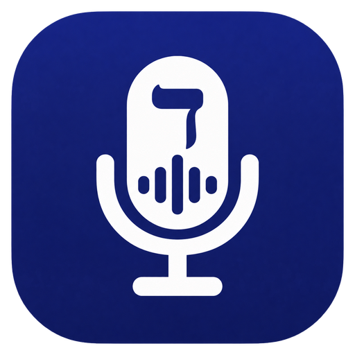

  

<h1 align="center">Dibbur (דיבור)</h1>

  <strong>Hebrew voice dictation for Mac that actually works.</strong> 
  Press a shortcut, speak Hebrew or Arabic, 
  and the text appears in any app. 
  Free and open source. Transcription runs locally. 
  Optional AI cleanup can use an online provider.

  <strong>הכתבה קולית בעברית ובערבית למק.</strong> 
  לוחצים על קיצור, מדברים עברית או ערבית, 
  והטקסט מופיע איפה שהסמן נמצא. 
  בחינם, בקוד פתוח, הכל נשאר על המחשב.

  <strong>إملاء صوتي بالعربي والعبري للماك.</strong> 
  تضغط على الاختصار وتحكي عربي أو عبري، 
  والنص بيطلع وين ما كان المؤشر. 
  مجاني ومفتوح المصدر، وكل شي محلي.

  
  
  
  
  

---

Dibbur is a free, open-source alternative to Wispr Flow and Dragon for Hebrew and Arabic speakers. It is a fork of [Handy](https://github.com/cjpais/Handy) (MIT) with one goal: make open-source dictation actually good in Hebrew.

## Why Dibbur?

- **Hebrew-first model** - includes the [ivrit-ai](https://huggingface.co/ivrit-ai) Whisper large-v3-turbo model (Apache-2.0).
- **Local transcription** - speech-to-text runs on your Mac. Optional AI cleanup may send transcript text to the provider you choose; it is off by default.
- **Works in every app** - hold your shortcut, talk, release: the text is pasted wherever your cursor is - WhatsApp, Gmail, Docs, Cursor.
- **Arabic too** - an optional Lahjat Turbo dialectal Whisper model. Accuracy varies with dialect, microphone and recording conditions.
- **Transcript archive (optional)** - turn on **Save Transcripts** in Settings > Advanced > History and every dictation is appended to a daily Markdown file in a local folder (default `~/Documents/Dibbur Transcripts`). Nothing leaves your Mac unless you put the folder inside iCloud Drive or Google Drive. Off by default.
- **Optional AI cleanup (off by default)** - removes Hebrew filler words (אממ, כאילו, נו...), fixes punctuation, keeps your language. Works with a free API key (Gemini, Groq), a local model through Ollama, or Apple Intelligence.

## Install (macOS)

Step-by-step with screenshots, in Hebrew: **[dibbur.pages.dev](https://dibbur.pages.dev)**.

1. Download the DMG from [Releases](https://github.com/ofershap/dibbur/releases/latest): `aarch64` for Apple Silicon (M1/M2/M3/M4), `x64` for Intel. (Apple menu > About This Mac says "Chip" for Apple Silicon, "Processor Intel" for Intel.)
2. Open the DMG and drag Dibbur into Applications.
3. **First launch - the app is not Apple-notarized, so macOS may block it.** Dismiss the warning, then open **System Settings > Privacy & Security**, scroll down and click **"Open Anyway"** next to the Dibbur message. Open Dibbur again and confirm.
4. **Grant the two permissions Dibbur needs:**
   - **Microphone** - macOS asks on the first recording; allow it. (Later: System Settings > Privacy & Security > Microphone.)
   - **Accessibility** - required so Dibbur can type into other apps: System Settings > Privacy & Security > Accessibility, add Dibbur from Applications and switch it on.
   - If the keyboard shortcut stops responding: System Settings > Privacy & Security > **Input Monitoring**, enable Dibbur.
5. First run downloads the **Ivrit Turbo** Hebrew model by itself (one-time ~1.6 GB) with a progress bar; adding Arabic is one optional tap on the same screen.
6. Press **Option+Space**, speak Hebrew, press it again (or hover the blue dot and click **סיום**) - the text is typed wherever your cursor is.

### Updating

Recent releases include an in-app update route. Follow the update prompt when available. For a manual reinstall, quit Dibbur, download the correct DMG from [Releases](https://github.com/ofershap/dibbur/releases/latest), and replace the app in Applications. If paste into other apps stops working afterward, remove Dibbur from Accessibility and add it again. Keep the installed version and any error message when [reporting an update problem](https://github.com/ofershap/dibbur/issues/new/choose).

## FAQ

Is Dibbur really offline?

Yes. Transcription runs locally with a Whisper engine on your machine, with no account and no cloud. Model downloads, update checks and optional remote text cleanup use the network. Remote cleanup is off by default.

Which Macs are supported?

Both Apple Silicon and Intel. Apple Silicon is strongly recommended - the large-v3-turbo model transcribes in near real time there; on Intel it works but is noticeably slower.

Can it transcribe English too?

Yes. The bundled Ivrit Turbo model is Hebrew-first but handles mixed Hebrew-English speech. You can also switch to any of the general Whisper and Parakeet models built into the app.

Is Dibbur Apple-notarized?

No. The Mac build workflow uses a self-signed identity, not an Apple Developer ID certificate or Apple notarization. A local code signature does not remove Gatekeeper warnings. Follow the installation steps above; no paid Apple account is needed to use Dibbur.

What about Arabic?

Pick the optional **Lahjat Turbo (Arabic)** model in Settings > Models. It is intended for dialectal Arabic. Results vary by dialect and recording quality; review important transcriptions.

Can I keep and search my past dictations?

Yes. Turn on **Save Transcripts** in Settings > Advanced > History (off by default) and every dictation is appended to a daily Markdown file in a folder you pick, default `~/Documents/Dibbur Transcripts`. Everything stays on your Mac; point the folder at iCloud Drive or Google Drive if you want it synced. To ask an AI assistant about the archive, the [`transcripts-mcp/`](transcripts-mcp/) folder in this repo is a small read-only MCP server that lists and searches it.

## Building

See [BUILD.md](BUILD.md) for local development and platform prerequisites. The manual **Mac Build (stable self-signed)** workflow creates Apple Silicon and Intel artifacts. Maintainers publish releases separately. Checks are path-filtered, not a guarantee that every push was tested. The upstream **Main Branch Build** workflow is intentionally disabled; it is separate from the Mac release route.

## Contributing

[Report a bug, ask a question or propose a feature](https://github.com/ofershap/dibbur/issues/new/choose). Code and documentation PRs are welcome; read [CONTRIBUTING.md](CONTRIBUTING.md) for setup, test evidence and the PR destination. AI-assisted contributions are welcome with disclosure and tests.

**Windows or Linux port?** Published Dibbur installers currently target macOS. Platform contributions are welcome, but a proposal or inherited upstream code is not a released port. Include your OS, architecture, build steps and what you tested.

Report vulnerabilities privately using [SECURITY.md](SECURITY.md).

## Credit

Nearly all of the code, and all of the hard problems (shortcuts, recording, VAD, paste, model engine), come from [Handy](https://github.com/cjpais/Handy) by [C.J. Pais](https://github.com/cjpais). The Hebrew speech model is by [ivrit-ai](https://www.ivrit.ai/) (Apache-2.0).

## Author

---

README built with [README Builder](https://ofershap.github.io/readme-builder/)

## License

[MIT](LICENSE) &copy; [Ofer Shapira](https://github.com/ofershap), same as upstream Handy.
